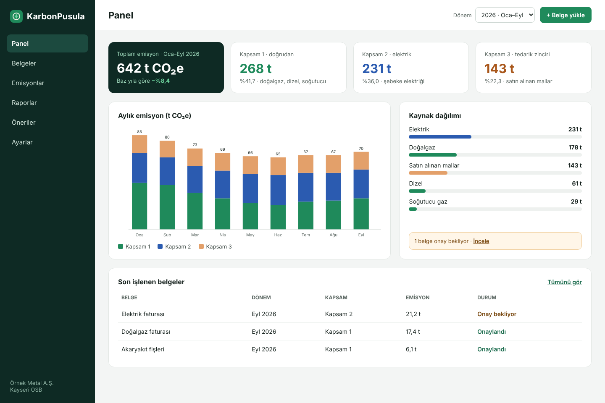
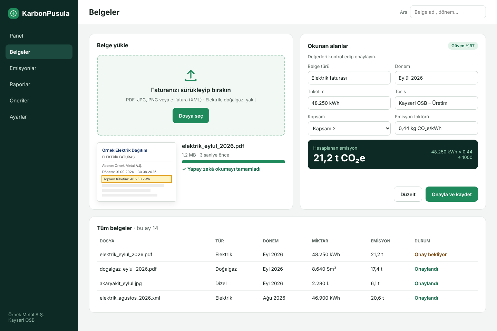
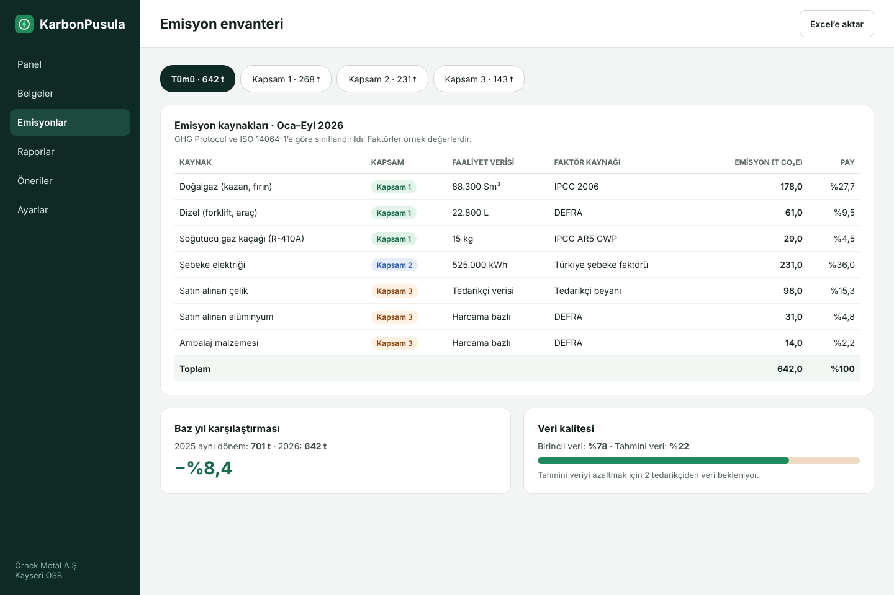
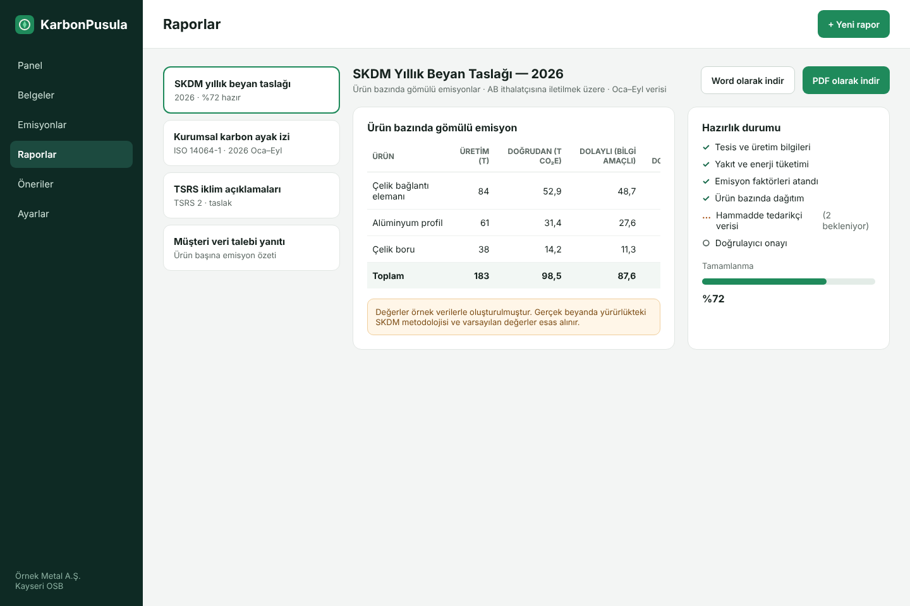
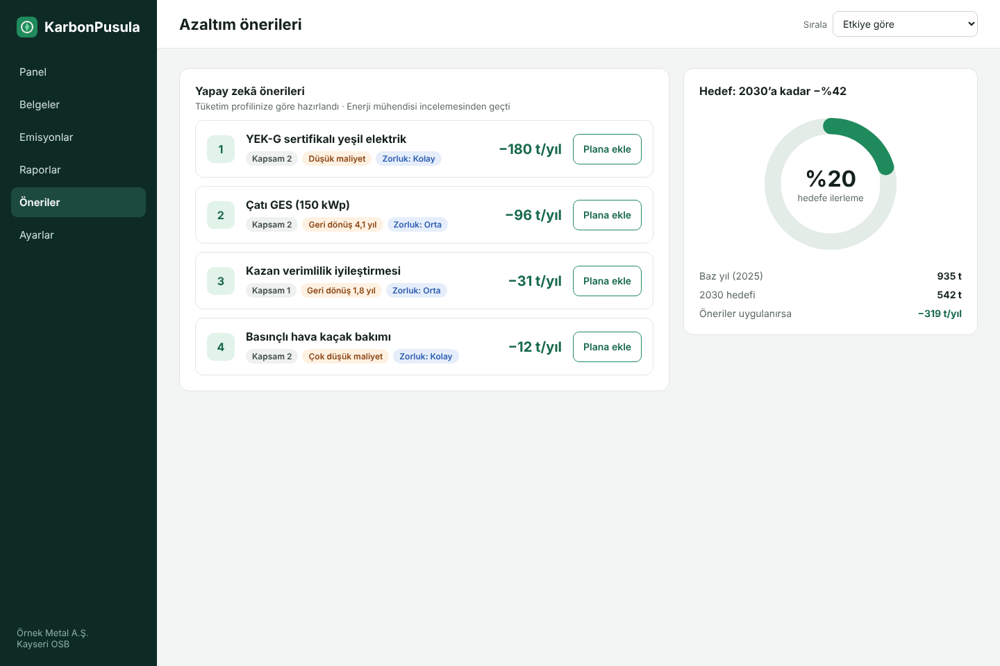
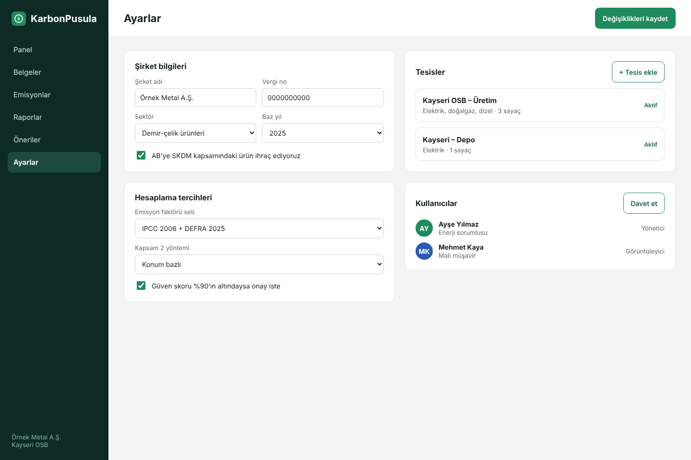

# KarbonPusula 🧭🌱

**AI-assisted carbon inventory and CBAM (SKDM) reporting for SMEs.**

🏆 **3rd place — COP31 Climate Technologies Creathon** (200+ applications from 3 countries, 10 finalists, final held in the COP31 Blue Zone)

🌐 <https://karbonpusula.sumertechnology.com>

> KarbonPusula is a commercial product of **Sumer Technology**. This repository is a **project showcase only** — it contains screenshots and a description, not source code.

---

## The problem

Small and medium-sized companies (KOBİ) that export to the EU now have to report the carbon footprint of their products under the EU Carbon Border Adjustment Mechanism (CBAM / SKDM). Most of them have no sustainability team. Their data is spread over electricity, natural gas and fuel invoices, and preparing a report by hand with a consultant takes weeks.

## The solution

KarbonPusula turns the documents a company already has into a carbon inventory:

1. **Upload invoices** — electricity, natural gas, fuel receipts and purchase documents
2. **AI reads them** — amounts, periods and energy types are extracted automatically; a person approves each document
3. **Emissions are calculated** by Scope 1 / 2 / 3 with standard emission factors
4. **Reports are ready** — CBAM-oriented reports that the company or its consultant can check and submit
5. **Reduction suggestions** — the biggest sources and practical actions to lower them

Consultants are users too: KarbonPusula does not replace them, it removes the manual data work so they can serve more companies.

## Screenshots

| Dashboard | Documents |
|---|---|
|  |  |
| **Emissions** | **Reports** |
|  |  |
| **Suggestions** | **Settings** |
|  |  |

*Screens show sample company data.*

## Vision

The first focus is invoice-based carbon accounting and CBAM reporting. Later, the plan is to connect banks and SMEs through **green credit** tracking and to grow into a network that covers the wider value chain.

## Team

Built by **Sumer Technology** — an interdisciplinary student engineering team working on robotics, software and AI.

- Enes Erdoğan — team captain, AI integration
- Oğuzhan Ceviz — software
- Fatih Mehmet Ayhan — renewable energy systems
- Burak Bekir Çakırer — embedded systems / hardware

---

© Sumer Technology. All rights reserved. The images in this repository may not be reused without permission.
